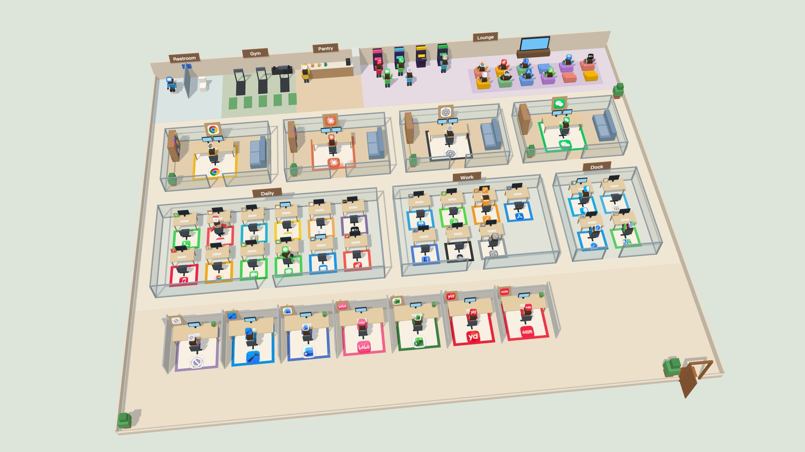
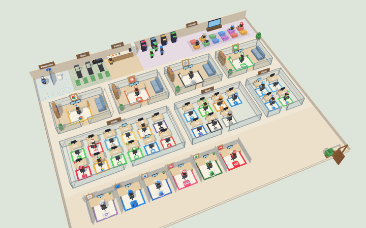
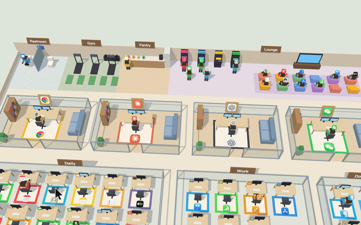
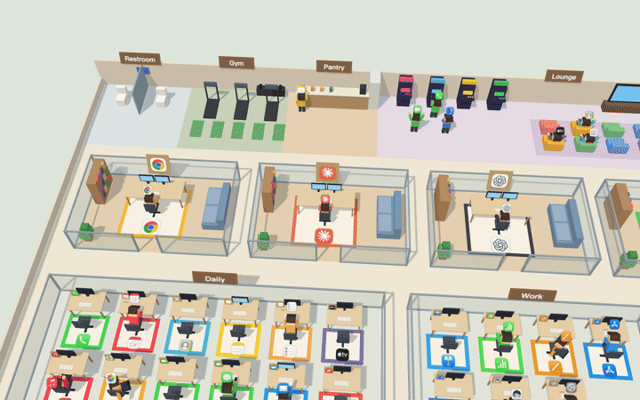
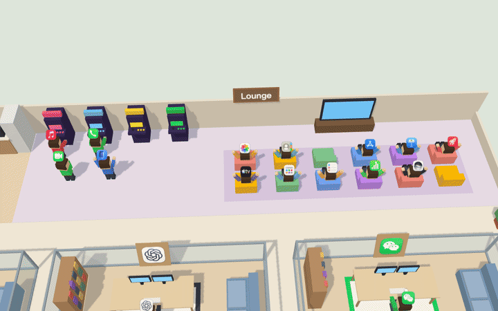
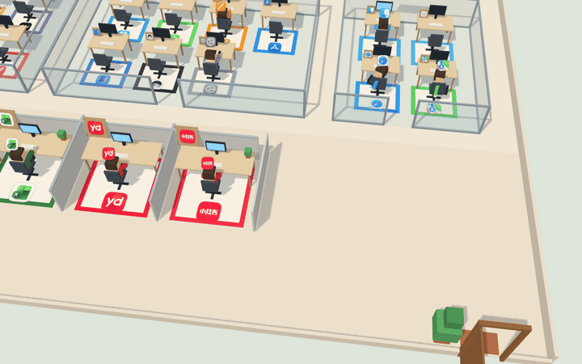
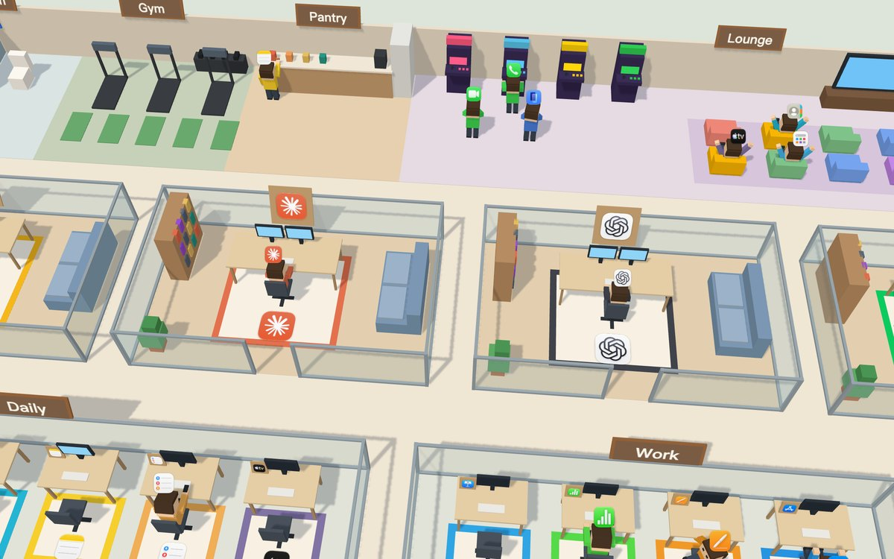

<div align="center">

# 🏢 AppOffice

**Your Mac's apps, reimagined as a tiny 3D office full of employees.**

Busy apps type away, frozen ones head to the restroom, everyone sprints to the gym when the Wi-Fi drops,<br>
memory hogs raid the pantry, and apps you haven't touched in a week slack off at the arcade.

[](https://github.com/MiWang0608/AppOffice/releases/latest/download/AppOffice.zip)


[](LICENSE)

[中文](README.md) · English



</div>

---

## ✨ At a glance



AppOffice is a **menu bar app**. Every second it checks each app on your Mac — is it running, in front, how much CPU and memory, frozen, offline — and has that app's little employee act it out. A desk toy that doubles as a launcher.

| The employee is… | Which means the app is… |
|---|---|
| ⌨️ Typing like mad (faster with more CPU, sweating at full load) | The one you're using |
| 💻 Typing | Busy in the background: the whole app (helpers and child processes included) averaged over 12% CPU in the last 5 s, held for 30 s — so an AI waiting on a server reply still counts |
| ☕ Sipping coffee | Open but idle |
| 🎒 Walking in with a backpack and a coffee | Launching |
| 🚽 In the restroom (queueing outside when it's full) | Frozen (spinning beach ball) |
| 🏋️ On a treadmill (push-ups when they're taken) | Your Mac is offline and this app used the network recently |
| 🍪 Snacking in the pantry | Using over 2 GB of memory in the background |
| 😴 Napping / scrolling a phone / spinning the chair / stretching | Not running |
| 🎮 Playing arcade games, lounging on bean bags, cheering others on | Not running and unused for 7 days (or never) |

## 📸 Highlights

### Hover over anyone to see what they're up to: state, CPU, memory, uptime



### Wi-Fi drops: everyone rushes to the gym; frozen apps queue for the restroom



### Long-forgotten apps hang out in the leisure area



### Drag an employee to the front door to quit the app



### Your favourite apps get glass-walled private offices



## 📦 Install

### Download (recommended)

1. Download **[AppOffice.zip](https://github.com/MiWang0608/AppOffice/releases/latest/download/AppOffice.zip)**, unzip it and drag **AppOffice** into Applications.
2. Open it. The first time, macOS says it can't verify the developer (the app isn't notarized with a paid Apple developer account). Click **Done**, then go to
   **System Settings → Privacy & Security → scroll down → Open Anyway** and confirm. After that it opens normally.
3. It lives in the **menu bar** (a little 🏢 building icon) — there's no Dock icon.

Requires macOS 14 or later. Runs natively on Apple silicon and Intel.

### Build from source

Needs Xcode (Swift 5.9+) and Node 22.

```bash
git clone https://github.com/MiWang0608/AppOffice.git
cd AppOffice
scripts/build-app.sh --install     # installs to ~/Applications
```

## 🎮 How to play

| Do this | And… |
|---|---|
| Hover over an employee | Their card pops up: state, CPU, memory, uptime; it hides when you move away |
| Click an employee | Pin the card until you click empty space |
| Double-click an employee or their desk | Launch the app, or switch to it if it's running |
| Drag an employee to the front door (bottom right) | Quit the app (like ⌘Q — unsaved documents still prompt) |
| Drag empty space / scroll / double-click empty space | Rotate (±30°) / zoom / reset the view |

**Menu bar 🏢**: Show Office, Keep on Top, Translucent When Idle (fades when the mouse is away), Edit Room List…, 语言 / Language, Enable Hang Detection…, Debug → Simulate State, Quit.

**Language**: the interface (signs, cards, menus, notifications) follows your system language — Chinese if your Mac is set to Chinese, English otherwise. Switch it any time under 语言 / Language in the menu.

## 🏠 Seat your apps: `rooms.json`

Who sits where lives in `~/Library/Application Support/AppOffice/rooms.json`. Open it from the menu bar with **Edit Room List…**; save and the office rearranges **right away**.

```json
{
  "offices": ["Google Chrome", "Claude", "ChatGPT", "WeChat"],
  "rooms": [
    { "name": "Daily", "apps": ["Phone", "Calendar", "Notes", "Mail"] },
    { "name": "Work", "apps": ["Keynote", "Numbers", "Pages"] },
    { "name": "Dock", "apps": ["Finder", "Safari"], "dock": true }
  ]
}
```

| Key | Meaning |
|---|---|
| `offices` | Each app gets its own glass-walled office (four per row, then wraps) |
| `rooms` | Shared rooms in order, one desk per app; `name` goes on the door sign |
| `"dock": true` | Dock apps that aren't listed anywhere sit in this room; without it they only show up as temps while running |
| App names | As shown in Applications or the Dock (case-insensitive, localized names work), or a bundle id such as `com.google.Chrome` |

- Listed apps always have a seat if they're installed, running or not; missing apps are skipped.
- On first launch the file is generated from your Dock: one shared room called Dock, no private offices.
- A typo (missing comma or quote) triggers a notification with the line number, and the previous layout stays. TextEdit's curly quotes and trailing commas are tolerated.
- Apps that are neither listed nor in the Dock are **temps**: they walk in through the front door when launched and get their own cubicle at the bottom — as many cubicles as there are temps.

## 🔐 Permissions

- **Accessibility** (only needed for the restroom / hang detection): choose **Enable Hang Detection…** from the menu and switch AppOffice on in System Settings. Everything else works without it.
- If you rebuild from source, macOS sees a new app and the old switch silently stops working: remove AppOffice (−) under System Settings → Privacy & Security → Accessibility and add it again.

## 💡 Tips

- The panel never steals focus, so Esc can't close a card — click empty space instead.
- The packaged app and `swift run` keep separate settings (pin, translucency, window position).

## 🛠 Development

```bash
npm --prefix web run build             # build the web scene first
swift run AppOffice                    # run (uses web/dist from the repo)
APP_OFFICE_LOG=1 swift run AppOffice   # log messages to/from the web page
swift run officectl                    # watch states in the terminal, no window
swift test                             # Swift tests
npm --prefix web test                  # web tests
scripts/build-app.sh --universal --zip # release build (Apple silicon + Intel)
```

- Web scene only: `cd web && npm run dev`, then open `http://localhost:5173/` (mock data with buttons to go offline, freeze an app, add temps…). See [`web/README.md`](web/README.md).
- Inspect the running page: Safari → Develop menu → AppOffice.
- Architecture: a Swift shell (menu bar; samples CPU, memory, hangs and network) hosting a Three.js scene in a WKWebView. Everything is built from boxes in code — no model files. Design notes live in [`docs/superpowers/`](docs/superpowers/) (Chinese).

## 📄 License

[MIT](LICENSE). App icons shown in the screenshots belong to their respective owners.
