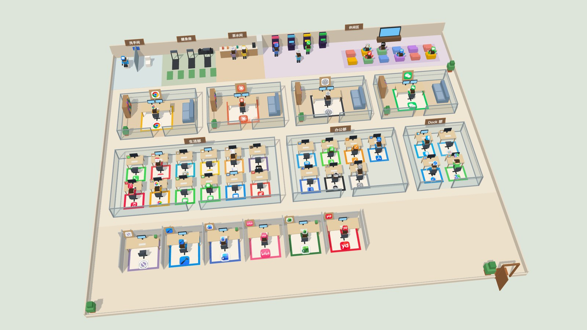
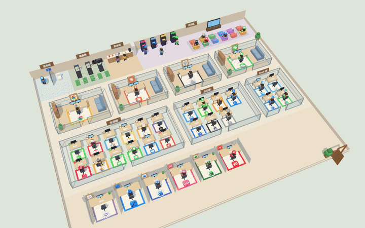
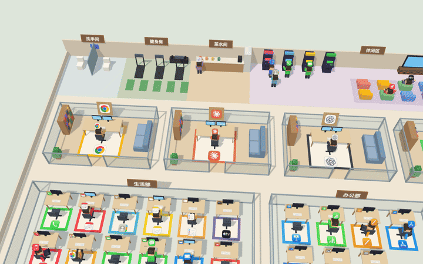
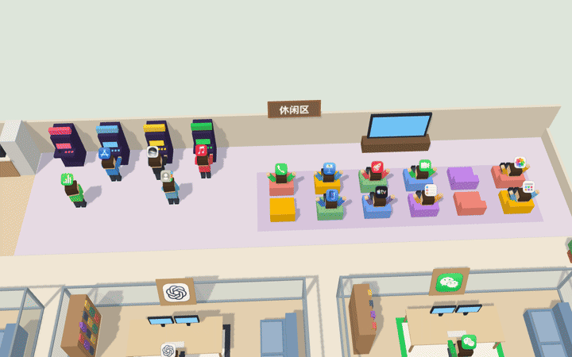
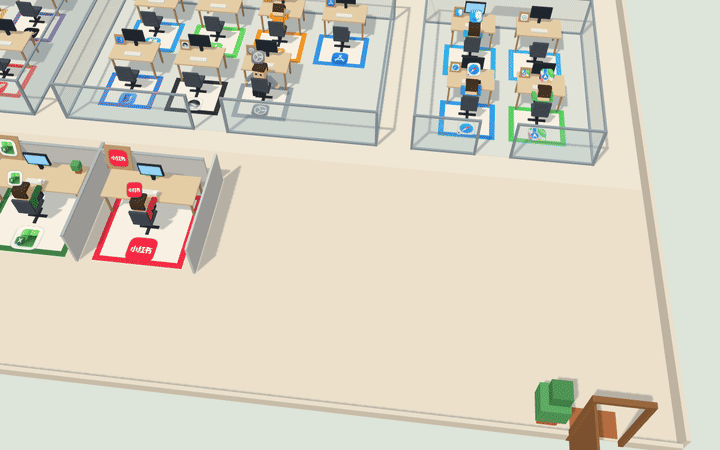
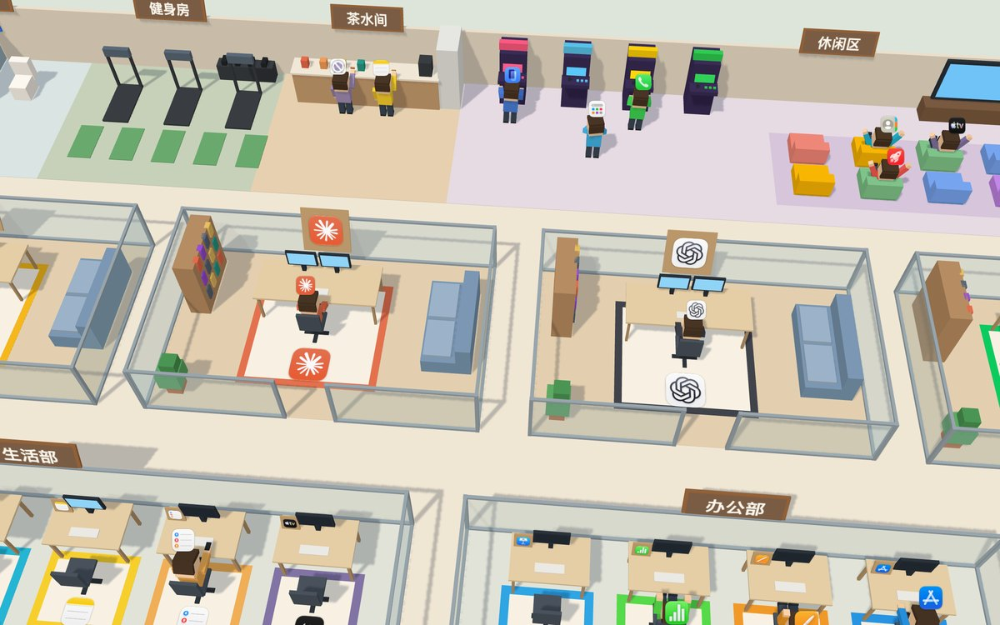

<div align="center">

# 🏢 AppOffice · 摸鱼办公室

**把你 Mac 上的 app 变成一群打工人，塞进一个 3D 小办公室。**

开着的在打字，卡住的去上厕所，断网了全员冲去健身房，<br>
吃内存的去茶水间，很久没用的在休闲区打游戏机。

[](https://github.com/MiWang0608/AppOffice/releases/latest/download/AppOffice.zip)


[](LICENSE)

中文 · [English](README.en.md)



</div>

---

## ✨ 一眼看懂



AppOffice 是一个**菜单栏小工具**：每秒看一眼你电脑上每个 app 的状态（开没开、在不在用、CPU、内存、卡没卡、断没断网），然后让对应的小人去做对应的事。可以当个桌面小摆件，也可以当启动器用。

| 小人在干嘛 | 说明这个 app |
|---|---|
| ⌨️ 疯狂打字（CPU 越高打得越快，满了冒汗） | 你正在用它 |
| 💻 打字 | 在后台干活：整个 app（含 Helper 和它启动的子进程）最近 5 秒平均 CPU 超过 12%，之后保持 30 秒（AI 在等服务器回复也算在干活） |
| ☕ 喝咖啡 | 开着但闲着 |
| 🎒 背着包端着咖啡走进来 | 正在启动 |
| 🚽 去洗手间（坑位满了门口排队跺脚） | 卡住了（转彩球） |
| 🏋️ 去健身房跑步机（满了做俯卧撑） | 电脑断网，而且这个 app 最近联过网 |
| 🍪 去茶水间吃零食 | 后台占了 2 GB 以上内存 |
| 😴 趴桌睡觉 / 刷手机 / 转椅子 / 伸懒腰 | 没打开 |
| 🎮 去休闲区打游戏机、窝懒人沙发看电视、围观 | 没打开，而且 7 天没用过（从没用过也算） |

## 📸 名场面

### 断网了，全员冲向健身房；卡住的去厕所排队



### 很久没用的 app 在休闲区自由活动



### 把小人拖到大门 = 让这个 app 下班（退出）



### 常用的 app 有自己的玻璃大办公室



## 📦 安装

### 直接下载（推荐）

1. 下载 **[AppOffice.zip](https://github.com/MiWang0608/AppOffice/releases/latest/download/AppOffice.zip)**，解压，把 **AppOffice** 拖进「应用程序」。
2. 双击打开。第一次会提示「无法验证开发者」（这个 app 没有付费的苹果开发者签名），点「完成」，然后：
   **系统设置 → 隐私与安全性 → 往下翻 → 「仍要打开」**，再确认一次就行。以后正常双击。
3. 它只在**菜单栏**出现（右上角一个🏢小楼图标），没有 Dock 图标。

需要 macOS 14 或更新，Apple 芯片和 Intel 都能用。

### 从源码装

需要 Xcode（Swift 5.9+）和 Node 22。

```bash
git clone https://github.com/MiWang0608/AppOffice.git
cd AppOffice
scripts/build-app.sh --install     # 装到 ~/Applications
```

## 🎮 怎么玩

| 操作 | 效果 |
|---|---|
| 单击小人 | 名片：状态、CPU、内存、开了多久 |
| 双击小人或他的座位 | 没打开就启动，开着就切过去 |
| 把小人拖到右下角大门 | 退出这个 app（和 ⌘Q 一样，没保存的文档 app 会自己问你） |
| 拖空白处 / 滚轮 / 双击空白处 | 转视角（±30°）/ 缩放 / 复位 |

**菜单栏🏢**：显示办公室、钉在最上层、透明模式（鼠标不在窗上时半透明）、编辑房间名单…、开启卡顿检测…、调试 → 模拟状态、退出。

## 🏠 自己安排座位：`rooms.json`

谁坐哪由 `~/Library/Application Support/AppOffice/rooms.json` 决定。菜单栏 →「**编辑房间名单…**」打开它，改完保存，办公室**马上**重新排座。

```json
{
  "offices": ["Google Chrome", "Claude", "ChatGPT", "WeChat"],
  "rooms": [
    { "name": "生活部", "apps": ["Phone", "Calendar", "Notes", "Mail"] },
    { "name": "办公部", "apps": ["Keynote", "Numbers", "Pages"] },
    { "name": "Dock 部", "apps": ["Finder", "Safari"], "dock": true }
  ]
}
```

| 写法 | 意思 |
|---|---|
| `offices` | 每个 app 一间玻璃墙大办公室（一排放 4 间，多了换行） |
| `rooms` | 合用的小办公室，按顺序排，一人一张桌子；`name` 挂在门口 |
| `"dock": true` | Dock 里不在名单上的 app 也坐进这间；没有哪间这么写，它们就只在打开时当临时工 |
| app 名字 | 和「应用程序」或 Dock 上看到的名字一样（不分大小写，中文名也行），也可以写 bundle id，比如 `com.google.Chrome` |

- 名单上的 app 装了就有座位，打开、干活都在自己的座位上；没装的自动跳过。
- 第一次打开时会按你的 Dock 生成一份：一间叫 Dock 的小办公室，没有大办公室。
- 写错了（少个逗号、引号）会弹通知告诉你第几行，办公室先按上一版排。「文本编辑」自动换成的弯引号、末尾多余的逗号会自动忽略。
- 不在名单上、也不在 Dock 里的 app：打开时是**临时工**，从大门走进来，坐最下面的独立隔间，开几个就有几个。

## 🔐 权限

- **辅助功能**（只有「卡住了去厕所」要用）：菜单里点「开启卡顿检测…」，在系统设置里把 AppOffice 的开关打开。不开的话其他功能照常，只是没人去洗手间。
- 自己从源码重新打包后，系统会把它当成一个新程序，原来的开关看着是开的其实已经失效：在 系统设置 → 隐私与安全性 → 辅助功能 里把 AppOffice 删掉（−）再加回来。

## 💡 小贴士

- 浮窗不抢焦点，所以按 Esc 关不了名片，点一下空白处就行。
- 打包的 app 和 `swift run` 的设置（钉住、透明、窗口位置）是分开存的。

## 🛠 开发

```bash
npm --prefix web run build             # 先打包网页
swift run AppOffice                    # 运行（会用仓库里的 web/dist）
APP_OFFICE_LOG=1 swift run AppOffice   # 打印和网页之间的消息
swift run officectl                    # 终端里看状态，不开窗口
swift test                             # Swift 测试
npm --prefix web test                  # 网页测试
scripts/build-app.sh --universal --zip # 打发布包（Apple 芯片 + Intel）
```

- 只调网页：`cd web && npm run dev`，浏览器打开 `http://localhost:5173/`（假数据，左上角有断网、卡住、来临时工之类的按钮）。详见 [`web/README.md`](web/README.md)。
- 调试运行中的网页：Safari →「开发」菜单 → 找到 AppOffice。
- 结构：Swift 外壳（菜单栏、采样 CPU / 内存 / 卡顿 / 网络）+ WKWebView 里的 Three.js 场景，所有东西都是方块拼的，不用任何模型文件。设计文档在 [`docs/superpowers/`](docs/superpowers/)。

## 📄 许可证

[MIT](LICENSE)。截图里的 app 图标归各自的公司所有。
